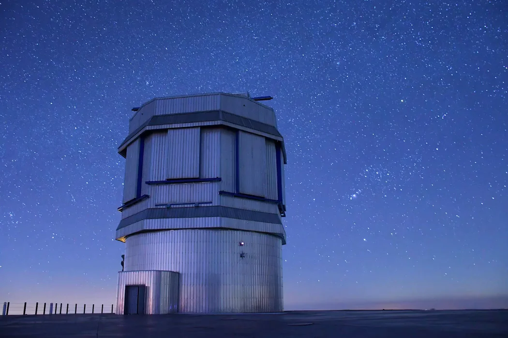

# INOOR: Iranian National Observatory Optical Reduction

[](https://doi.org/10.5281/zenodo.23879448)

<p align="center">
  
</p>

INOOR is a Python-based pipeline with a graphical user interface (GUI) designed for the data reduction and analysis of imaging observations obtained with the 3.4-meter telescope of the Iranian National Observatory (INO340). INOOR builds master calibration frames, calibrates and cleans the science frames, solves the astrometry, and performs aperture photometry on single frames and long time series, producing light curves and atmospheric extinction coefficients. Designed for transient follow-up, when complete calibration sets are often unavailable, it can construct an auto-flat directly from the science frames and remove cosmic rays and hot pixels in post-processing. Apertures can be set by FWHM scaling, signal-to-noise optimization, or the curve of growth, adapting to varying seeing and other changes in the PSF. INOOR is a step toward a more automated pipeline for the rapid follow-up of transients in the era of the Vera C. Rubin Observatory.

The methods behind its main choices, and their tests on INO340 data, are described in the INOOR paper.

## What it does

**Create Master** combines bias, dark and flat frames with a mean or a median, with optional sigma clipping. Flats of different brightness, such as twilight flats, can first be scaled to the same level.

**Calibration** applies the master frames to the light frames. If there are no flat frames, it can divide each light frame by an auto-flat fitted to that frame's own sky. Removal of cosmic rays, replacement of bad pixels and binning of the output are optional.

**Multi Photometry** measures aperture photometry on one frame or on a long series. A source is followed through a series with the stars of the field, so no plate solution is needed. By default all stars of a frame share one radius, k times the frame FWHM; a separate radius per star, from its SNR peak or its curve of growth, is also available. Error bars use the gain and read noise measured for the camera channel and binning of each frame, read from the header. Saturated stars and stars broader than the frame PSF are flagged. The tab can also compute zeropoints and extinction coefficients and draw light curves.

**Astrometry** uploads a frame to [astrometry.net](https://nova.astrometry.net) and saves a copy with the solution in its header, distortion terms included. It marks the reference stars and the detected sources; clicking a marker gives its RA and Dec, and a button queries Pan-STARRS1 for its magnitudes through the MAST API.

## Installation

INOOR runs from source and needs Python 3.11 or 3.12.

```bash
git clone https://github.com/hosseintd/INOOR.git
cd INOOR
conda create -n inoor python=3.12
conda activate inoor
pip install -r requirements.txt
python main.py
```

Plate solving and the Pan-STARRS1 lookups need an internet connection. Plate solving also needs a free API key from [astrometry.net](https://nova.astrometry.net/api_help): paste it into the Astrometry tab, or set the `ASTROMETRY_API_KEY` environment variable before starting INOOR.

To run the tests, install `requirements-dev.txt` instead and run `python -m pytest` from the repository root.

## Getting started

Work through the tabs from left to right. The Welcome / Guide tab explains each one. INOOR was built for the FLI Kepler KL4040 camera of INO340; the measured detector values live in `core/camera_config.py`, and another camera needs its own values there.

## Citation

If you use INOOR in your work, please cite it. The reference for the code is in `CITATION.cff` (DOI of version 1.0.0: [10.5281/zenodo.23879448](https://doi.org/10.5281/zenodo.23879448)); the reference for the paper will be added to the repository when the paper is published.

## Credits

*   **Developer:** [Hossein Torkzadeh](https://github.com/hosseintd) and Soroush Shakeri (Advisor)
*   Special thanks to Parisa Hashemi, Saeid Karimi Mianrudi, Hamed Altafi and Reza Rezaei for their invaluable comments and fruitful discussions.
*   We also thank the INO340 Scientific and Technical staff.

Banner image: INO timelapse by Saeid Karimi.

Copyright (C) 2026 Hossein Torkzadeh. INOOR is free software, released under the GNU General Public License version 3; see `LICENSE`.
